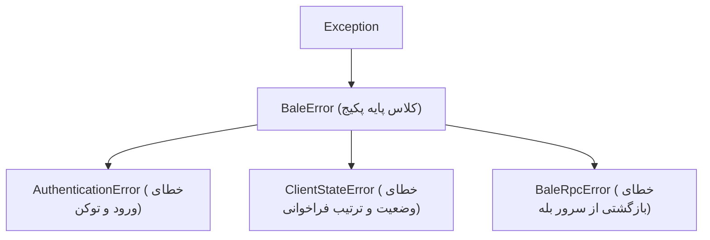

# ⚠️ مدیریت خطاها و استثناها (Errors & Exceptions)

کتابخانه **BaleNova** سیستم ساختاریافته و تایپ‌شده‌ای برای مدیریت خطاها دارد تا اسکریپت‌ها و ربات‌های شما در شرایط قطعی شبکه، خطای مجوزها یا محدودیت‌های سرور متوقف نشده و به نرمی خطاها را مهار نمایند.

---

## ۱. سلسله‌مراتب کلاس‌های استثنا (Exceptions Hierarchy)



| کلاس استثنا | شرایط رخداد | اتریبیوت‌های کلیدی |
| :--- | :--- | :--- |
| `BaleError` | کلاس ریشه برای تمامی خطاهای درون این کتابخانه | `args`, `message` |
| `AuthenticationError` | نامعتبر بودن توکن JWT، اشتباه بودن کد پیامک یا رمز عبور دومرحله‌ای | `message` |
| `ClientStateError` | فراخوانی متد پیش از اتصال (`connect`) یا عدم وجود نشست فعال | `message` |
| `BaleRpcError` | خطای ارسال‌شده مستقیماً از سوی سرور بله | `code`, `message`, `reason`, `details` |

---

## ۲. کدهای خطای استاندارد سرور بله (`RpcStatus`)

سرورهای بله از کدهای استاندارد gRPC در پاکت‌های پاسخ خود استفاده می‌کنند:

| کد عددی | شناسه وضعیت | مفهوم و علت | راهکار پیشنهادی |
| :---: | :--- | :--- | :--- |
| `3` | `INVALID_ARGUMENT` | آرگومان ارسالی اشتباه است (مثلاً متن خالی یا شناسه نامعتبر) | پارامترها و فرمت ورودی متد را اصلاح نمایید. |
| `5` | `NOT_FOUND` | کاربر، چت یا پیام مورد نظر یافت نشد | بررسی کنید آیدی یا یوزرنیم معتبر باشد. |
| `7` | `PERMISSION_DENIED` | حساب شما دسترسی لازم برای این اکشن را ندارد (مثلاً عدم ادمین بودن) | سطح دسترسی یا مجوزهای گروه را بررسی کنید. |
| `8` | `RESOURCE_EXHAUSTED` | محدودیت تعداد درخواست (Rate Limit / Flood) | مقداری تاخیر (`asyncio.sleep`) اضافه کنید. |
| `14` | `UNAVAILABLE` | سرور موقتاً در دسترس نیست یا تایم‌اوت شبکه رخ داده | درخواست را پس از چند ثانیه با مکانیزم Retry تکرار کنید. |
| `16` | `UNAUTHENTICATED` | نشست منقضی شده یا باطل گردیده است | مجدداً لاگین کنید یا توکن جدید دریافت نمایید. |

---

## ۳. نمونه کدهای مهار حرفه‌ای خطاها

### مدیریت خطای وضعیت و RPC سرور
```python
import asyncio
from bale import Client
from bale.errors import BaleRpcError, ClientStateError, RpcStatus

async def main():
    async with Client.from_firefox() as client:
        try:
            # تلاش برای ارسال پیام به چت نامعتبر
            await client.send_message("invalid_chat_username", "سلام!")
        except BaleRpcError as e:
            if e.code == RpcStatus.NOT_FOUND:
                print("❌ کاربری با این مشخصات یافت نشد!")
            elif e.code == RpcStatus.RESOURCE_EXHAUSTED:
                print("⚠️ محدودیت نرخ ارسال! لطفاً ۱۰ ثانیه صبر کنید...")
                await asyncio.sleep(10)
            else:
                print(f"خطای سرور بله ({e.code}): {e.message}")
        except ClientStateError:
            print("خطا در وضعیت کلاینت؛ ابتدا باید کانکت شوید!")

asyncio.run(main())
```
